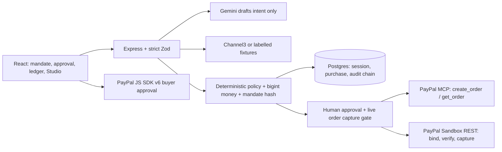

# IntentLock

> AI proposes. Code enforces. You approve.

A buyer-side deterministic policy gate between AI shopping agents, the **PayPal MCP Server** and **PayPal Orders v2 (Sandbox)**. Specification: [spec/README.md](spec/README.md).

Small-business buyers should be able to delegate product discovery without delegating the right to change a budget, merchant or subscription policy. IntentLock separates AI interpretation from deterministic authorization and human approval.

**Status:** Local release evidence is in [TESTING.md](TESTING.md). Hosted smoke, public video, Devpost submission and release tagging are pending. Sandbox only: no real merchant purchase.

**Release blocker:** `npm audit --omit=dev` currently reports 13 runtime dependency vulnerabilities (12 high, one moderate), primarily in the pinned PayPal MCP/toolkit tree. The CI audit gate is intentionally not bypassed; see [TESTING.md](TESTING.md).

## Architecture



## Quick start

Requires Node 22+, a hosted Postgres URL and your own PayPal Sandbox app. From a clean clone, use these **five commands**, editing the copied environment file before migration. No Docker required.

```bash
npm ci
copy .env.example .env
npm run db:migrate
npm run dev
npm run dev:web
```

The last two commands run in separate terminals: API on `http://localhost:3000`, UI on `http://localhost:5173`. On macOS/Linux replace `copy` with `cp`. Set `DATABASE_URL`, a random `SESSION_SECRET` (at least 32 characters), `PAYPAL_CLIENT_ID` and `PAYPAL_CLIENT_SECRET` before command three; keep `.env` private.

Production: `npm run build`, then `node apps/api/dist/server.js` serves the API and the built SPA (see [render.yaml](render.yaml)).
With `AI_PROVIDER=rule` and `PRODUCT_SOURCE=fixture`, Gemini and Channel3 keys are not needed.

## Checks

```bash
npm run typecheck && npm run lint && npm test && npm run build
npm run openapi:check
npm run security:bundle
npx playwright install chromium
npm run e2e
```

Tests need no secrets: Postgres is PGlite in-process; E2E uses the real browser app with an intercepted PayPal SDK, MSW Sandbox REST, stub stdio MCP and mocked Gemini Studio turns. These checks do not replace a real Sandbox smoke test. CI runs all checks above plus formatting, gitleaks and a runtime dependency audit. [OpenAPI 3.1](docs/openapi.yaml) is generated from shared Zod schemas with `npm run openapi:generate`; CI rejects drift.

## Mandate and purchase flow (Stage 2)

In fixture mode, create a mandate with `POST /api/mandates`, confirm it with
`POST /api/mandates/:id/confirm`, then search with `POST /api/mandates/:id/search`.
Create a purchase only from an `ALLOWED` result using `POST /api/purchases`; the API
re-evaluates the offer and computes its total and mandate hash on the server. Approve
with `POST /api/purchases/:id/approve` by echoing that hash, or cancel with
`POST /api/purchases/:id/cancel`. See [e2e/api-flow.http](e2e/api-flow.http).

## Payment integrity (Stage 3)

After the mandate flow above, explicitly approve the purchase hash, create a PayPal
order, approve it in the Sandbox popup, then capture. The temporary auto-approved
`/api/dev/purchases` route has been removed. The small web smoke-test screen now
confirms a sample mandate and requires a separate purchase approval before PayPal.

Before capture the server checks the live order ID/status, amount/currency,
`custom_id`, protected mandate hash/merchant, current policy and approval expiry.
Failures become `BLOCKED_AT_CAPTURE` with structured findings; PayPal is not captured.
MCP read failures fall back to REST. If both reads fail, the API returns `504` and
leaves the purchase retryable in `ORDER_CREATED`.

The pinned MCP tool accepts only `currencyCode`, `items`, discount/shipping fields,
notes and return/cancel URLs. It cannot accept purchase bindings or a request ID.
After MCP creation, the server persists the returned order ID, then uses verified
[Orders v2 PATCH](https://developer.paypal.com/docs/api/orders/v2/#orders_patch)
support to set `custom_id` and `invoice_id`, and verifies them **before** exposing
the order ID to the browser. No order is patched after buyer approval. A known
order's failed binding can be retried without another create call. An unknown
MCP create outcome is not automatically replayed; it requires manual reconciliation.
The REST create fallback supplies the bindings and stable request ID at creation.

Capture uses a stable stored `PayPal-Request-Id`. A timeout stays `CAPTURING`,
not falsely failed. Reading a purchase after 60 seconds reconciles its live
capture evidence; an approved, uncaptured order can then be retried with the same
request ID and all gates rerun. `CAPTURE_PENDING` is also reconciled on read.

## Audit and demo controls

- `GET /api/audit?limit=50&cursor=...&decision=BLOCKED&state=BLOCKED_AT_CAPTURE&seeded=false`
  returns a session-scoped, cursor-paginated offer/purchase ledger. Filters are optional.
- `GET /api/purchases/:id/receipt` and `GET /api/offers/:id/receipt` return the
  mandate, findings, approval, MCP trace summaries and relevant audit events.
- `GET /api/audit/verify` recomputes the whole session chain, returning `INTACT`
  and `checked`, or `BROKEN` with a string `firstBrokenSeq` and zero-based
  `firstBrokenIndex`. Event sequence numbers cross the wire as strings.
- With `DEMO_CONTROLS_ENABLED=true`, `POST /api/purchases/:id/simulate-drift`
  accepts `{"kind":"PRICE_HIKE"}`, `MERCHANT_SWAP` or `APPROVAL_EXPIRED`, only in
  `ORDER_CREATED`. It changes only the override, not approved mandate/snapshot
  fields, and can only add gate failures.
- `POST /api/demo/seed {}` inserts one sample mandate, four evaluated offers and
  two purchases (sample capture and drift block). Every sample is labelled,
  events use the normal chain, and no PayPal/MCP calls occur. Repeating it in the
  same session returns the original counts without inserting anything.
- Both demo routes return `404` when disabled. Sample purchases cannot call PayPal.

Audit appends share the state-changing transaction and lock the session row first.
Database triggers prohibit updates, deletes and truncation of audit events.
Strict-schema rejections are audited using unexpected field names, never values.
Run migrations before starting this version. Existing pre-audit history is not
backfilled or presented as verified event evidence.
Pre-audit purchases must be recreated through the mandate and human-approval
flow to obtain the evidence required by the full capture gate.

The automated drift-to-`INTACT`, stub-MCP happy path and ten-way concurrent capture
checks run in `npm test`. Coverage:
`npm run test -w apps/api -- --coverage` (95% minimum core lines and branches).
These local checks are not a claim that hosted Render or live PayPal Sandbox
checkout has been verified.

## Procurement and governance UI (Stage 4)

The web app provides a five-step request, mandate, offer, approval and checkout
flow; a session-scoped AG Grid Community audit ledger with receipt and chain
verification; and an AG Studio governance dashboard with the Mandate Integrity
& MCP Gate widget. Demo controls are labelled and only available when enabled.
The Governance Analyst is optional, requires `STUDIO_AGENT_ENABLED=true` and
Gemini configuration, and can call dashboard tools only; it has no payment or
PayPal MCP tools. Its API contracts are `GET /api/analytics/dataset` and
`POST /api/studio-agent/turn`; the latter returns AG-UI-compatible SSE events.

Local typecheck, lint, build and automated tests do not verify hosted scenarios,
live Gemini behavior, PayPal Sandbox checkout, or an AG Studio license key.

## Judge Quickstart & Test Scenarios

**Hosted demo:** pending deployment. Replace this line with the public URL after its health check and smoke test pass. No judge login or sandbox buyer credentials are published here; provide a dedicated sandbox buyer account through private Devpost testing instructions only. Never share a business account or app secret.

The UI scenario presets are **Allowed purchase**, **Over-budget offer**, and **Pre-capture drift**:

| Preset            | Expected result                                                                                                                                     |
| ----------------- | --------------------------------------------------------------------------------------------------------------------------------------------------- |
| Allowed purchase  | `northstar-office.example` chair is allowed; purchase requires approval, then PayPal Sandbox buyer approval and server verification before capture. |
| Over-budget offer | Higher-priced chair is blocked with `OVER_BUDGET`; no purchase is payable.                                                                          |
| Pre-capture drift | After approval, the demo drift override blocks capture with `DRIFT_AMOUNT_MISMATCH`; no capture call should occur.                                  |

Use **Load Sample Procurement History** to populate the ledger and dashboard without PayPal/MCP calls. Demo controls require `DEMO_CONTROLS_ENABLED=true`; use **Simulate Post-Approval Drift** only on a fresh `ORDER_CREATED` purchase. The Postman collection is [postman/IntentLock.postman_collection.json](postman/IntentLock.postman_collection.json); set its `baseUrl` and keep a consistent cookie jar for the signed session.

Exact happy path: **Allowed purchase → Draft mandate → Confirm mandate and find offers → Select offer** on the allowed chair **→ Approve this exact purchase → PayPal**, then approve with the dedicated Sandbox buyer. Expect **Captured - verified with PayPal (Sandbox)**. Open **View Intent Receipt** for `create_order`, `get_order` and capture evidence.

For drift, first choose **Start another request → Pre-capture drift**, repeat the same flow and leave **Simulate Post-Approval Drift at the next capture** checked. Buyer approval must end in `BLOCKED_AT_CAPTURE`, not a capture. The **Over-budget offer** preset has no selectable allowed chair. The ordinary allowed-purchase search also shows `RECURRING_NOT_ALLOWED` and `PRICE_UNKNOWN` examples. In **Audit ledger**, use **Quick filter**, sort a column, select a row for its receipt, then **Verify Audit Chain**. Seeded receipts explicitly say no payment occurred.

## Configuration and release limits

All settings and safe defaults are in [.env.example](.env.example):

| Variables                                                        | Purpose                                                                                                         |
| ---------------------------------------------------------------- | --------------------------------------------------------------------------------------------------------------- |
| `DATABASE_URL`, `SESSION_SECRET`                                 | Hosted Postgres; signed anonymous session. TLS verified off localhost.                                          |
| `PAYPAL_CLIENT_ID`, `PAYPAL_CLIENT_SECRET`, `PAYPAL_ENV=sandbox` | Required Sandbox app. Only the client ID is public.                                                             |
| `PAYPAL_MCP_COMMAND`                                             | Empty launches pinned `@paypal/mcp`; override only for a verified deployment.                                   |
| `AI_PROVIDER`, `AI_API_KEY`, `AI_MODEL`                          | `rule` is offline; `gemini` uses the Google GenAI adapter. Verify model access before recording.                |
| `PRODUCT_SOURCE`, `CHANNEL3_API_KEY`                             | `fixture` or live `channel3`; fallback is visibly labelled.                                                     |
| `APPROVAL_TTL_SECONDS`, `POLICY_VERSION`                         | Approval expiry and deterministic policy version.                                                               |
| `DEMO_CONTROLS_ENABLED`, `STUDIO_AGENT_ENABLED`                  | Explicit opt-in; enable demos and configure Gemini before showing the agent.                                    |
| `VITE_AG_STUDIO_KEY`                                             | Browser-visible build-time **license**, not a backend credential. Never put API secrets here or commit the key. |
| `NODE_ENV`, `PORT`                                               | Runtime environment and listener port; Render sets the port.                                                    |
| `PAYPAL_WEBHOOK_ID`                                              | Reserved for deferred P2 webhooks; not used by current checkout.                                                |

AG Studio is commercially licensed with a 45-day trial. Activation date, issued-key restrictions and expiry must be confirmed by the owner; no active trial is claimed. Missing-license behavior is not proof of permission to deploy.

Render is configured for its free web service; its scheduled keep-alive workflow pings `/api/health` every 10 minutes when the repository variable `RENDER_APP_URL` is set. A free Render Postgres database may expire: record its creation date, create and migrate a replacement before the expiry (target ~30 Nov for an early-November database), update `DATABASE_URL`, then enable demo controls temporarily and run **Load Sample Procurement History** in a fresh judge session. Verify `/api/health`, `/api/audit/verify`, and the happy path; never claim judge availability until those checks pass. Free-service sleeping and database-retention limits remain deployment risks.

Free Render has no pre-deploy hook, so startup migrates before listening and fails if migration fails. Scheduled Actions can be delayed; pings are not an uptime guarantee. Record the DB's actual expiry, preserve old evidence before replacement, and follow the [replacement runbook](spec/submission.md#7-judging-period-runbook-115-dec). The replacement is a new history, not continuity of the old audit chain.

## Judging criteria → evidence

| Criterion                | Inspectable evidence                                                                                                                                                                                  |
| ------------------------ | ----------------------------------------------------------------------------------------------------------------------------------------------------------------------------------------------------- |
| Technical implementation | [Payment service](apps/api/src/services/payments.ts), [MCP gateway](apps/api/src/adapters/paypalMcp/gateway.ts), [capture gate](apps/api/src/core/captureGate.ts); mocked happy path and drift tests. |
| Design                   | [Procurement flow](apps/web/src/App.tsx), [Community ledger and receipt](apps/web/src/Ledger.tsx), keyboard/axe E2E.                                                                                  |
| Potential impact         | Buyer-controlled budget, merchant and recurrence constraints; no claimed savings or adoption metrics.                                                                                                 |
| Innovation               | Server-bound mandate hash, fresh order verification and [hash-chained audit](apps/api/src/repo/audit.ts), rather than model-authorized payment.                                                       |
| Presentation             | [Devpost copy and recorder checklist](spec/submission.md), [timed 2:50 click script](spec/plan.md#7-demo-video-script-under-3-minutes); recording pending.                                            |

## Sponsor tools used

PayPal MCP, Orders v2 and JS SDK v6 mediate Sandbox checkout. Channel3 provides an optional live backend catalog; fixture results are not Channel3 evidence. AG Grid **Community** renders the ledger; commercial AG Studio supplies the governance layout and dashboard-agent tools. Gemini interprets intent and drives the optional dashboard agent, neither of which can authorize payment. Render configuration and a Postman collection support delivery; deployment and live provider usage must be verified before claiming sponsor evidence. GitHub Copilot assisted development. See [third-party notices](THIRD_PARTY_NOTICES.md).

## Limitations

- USD only, anonymous session scope, one selected product, Sandbox only. No real merchant fulfilment or production payment certification.
- Fixture merchants are fictional `.example` domains. Sample history is synthetic and cannot pay.
- P2 webhooks are deferred until G3 and hardening are green; pending captures reconcile on read.
- In-process PGlite integration tests are not certification against hosted Postgres, Render or live provider failure modes.
- Large Studio/browser chunks produce a Vite warning. Live license validity and free-tier uptime/expiry remain owner checks.

The planned video is not yet recorded or public, and the Devpost entry/tag are not yet submitted. Do not treat this repository checklist as proof of deployment or submission.

## License

MIT
