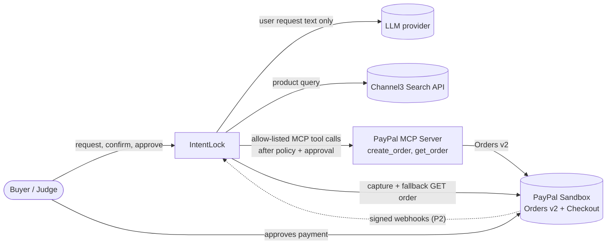
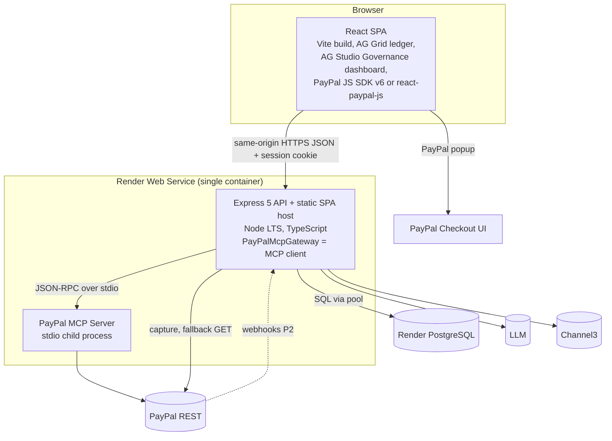
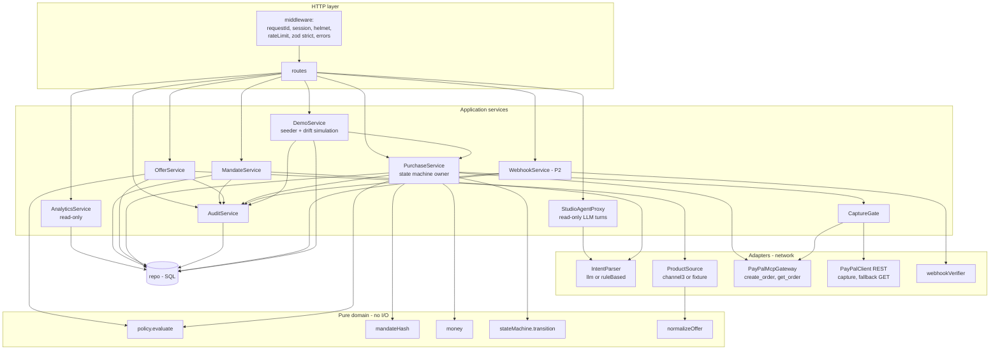
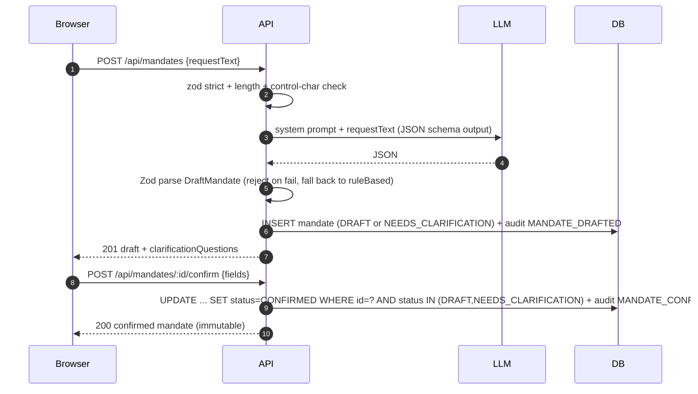
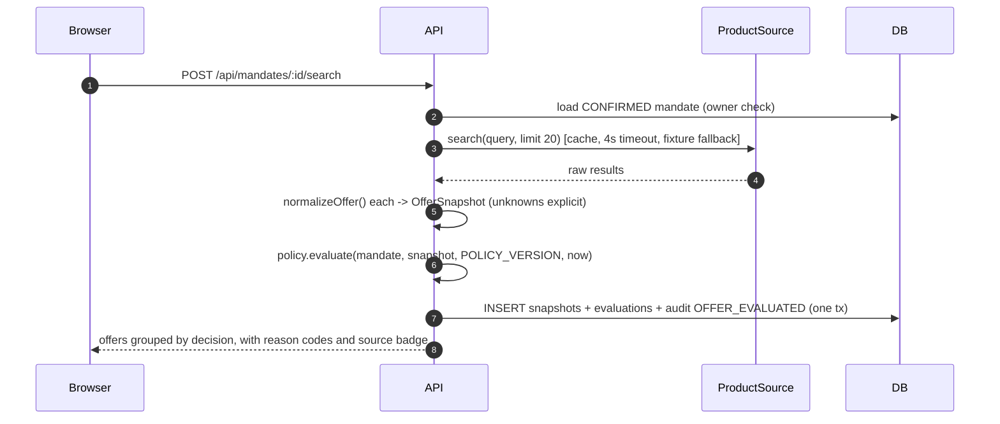
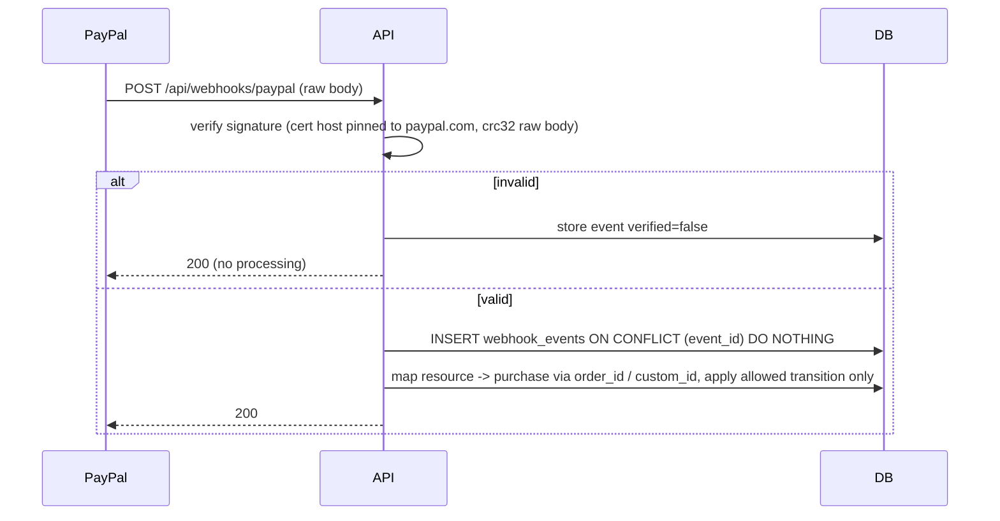
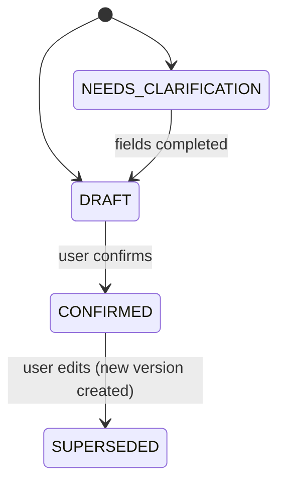
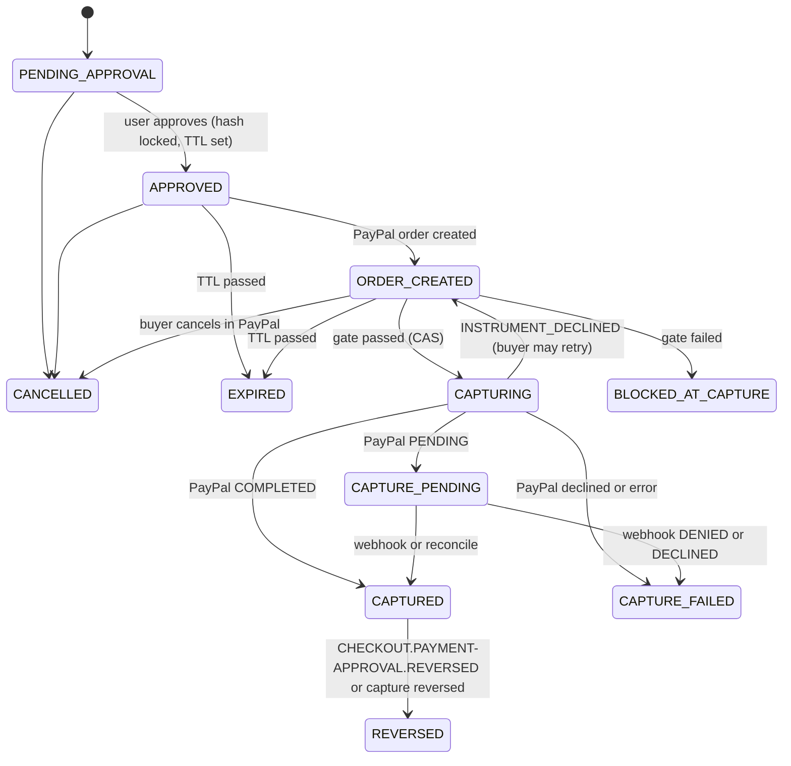
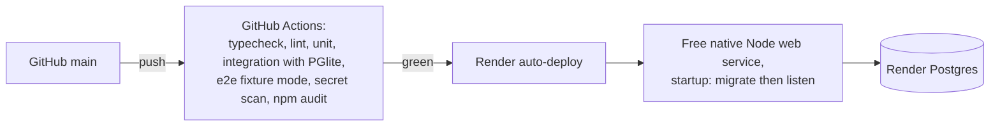
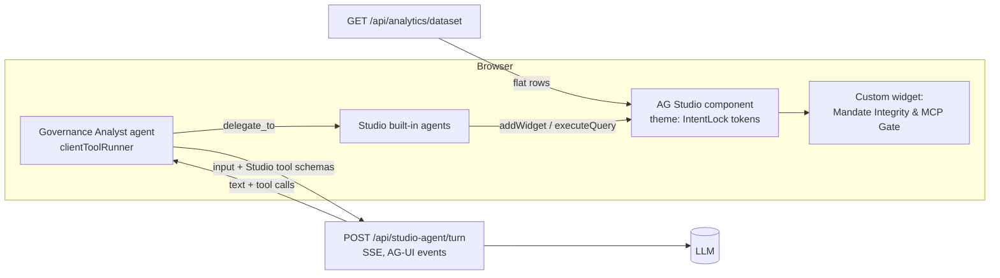

# IntentLock — Architecture

> **How** IntentLock is built. Requirements: [spec.md](spec.md). Evidence behind choices: [research.md](research.md). Schemas: [data-model.md](data-model.md). Routes: [contracts/api.md](contracts/api.md).

## 1. Architecture drivers

Ranked; when two conflict, the higher one wins.

| # | Driver | Architectural answer |
|---|---|---|
| 1 | **Payment integrity** — no capture outside the confirmed mandate | Pure policy engine + mandate hash + deterministic mediation of **PayPal MCP Server** tools + pre-capture gate against PayPal's own order record + DB compare-and-set state machine |
| 2 | **Auditability** | Append-only, SHA-256 hash-chained `audit_events` (`prevHash` + `entryHash`); every decision and MCP tool call persisted with `policyVersion` and input snapshot |
| 3 | **Ship all P0 in a 6-day sprint (target 04 Nov)** | Modular monolith, one deployable, one database, one LLM call per mandate draft |
| 4 | **Reproducibility for judges** | `docker compose up` / `npm run dev`, fixture mode, 1-click demo seeder, drift simulation toggle, judge scenario presets, Render blueprint |
| 5 | **Honest demo** | Source, `PayPal Sandbox`, `Simulated Drift` and sample-data badges; success only from verified PayPal status |

## 2. System context (C4 level 1)



Trust boundary: **everything outside `IntentLock` is untrusted input**, including the LLM, PayPal MCP tool results (Zod-validated before use) and PayPal webhooks (until signature-verified). Only deterministic server code holds an MCP client; the LLM and the AG Studio agent never see PayPal MCP tools.

## 3. Containers (C4 level 2)



**Why a single container:** same origin removes CORS and cross-site cookies, gives one CSP, one deploy, one log stream. The SPA is static files served by Express with long-cache hashed assets. The PayPal MCP Server runs as a local stdio child process of the API, so it opens no network listener and is unreachable from the browser.

## 4. Backend components (C4 level 3)

Modular monolith. Each module exposes a narrow service interface; only `routes/` touches HTTP; only `adapters/` touch the network; only `repo/` touches SQL.



| Module | Responsibility | Must never |
|---|---|---|
| `core/policy` | `evaluate(mandate, offer, policyVersion) → Evaluation`. Pure, total, deterministic. | Do I/O, read clock (time is passed in), call LLM |
| `core/mandateHash` | Canonical JSON of the 9 protected fields in §9 (sorted keys, minor units, lowercase domains) → SHA-256 hex | Include volatile fields (timestamps, IDs other than mandateId/offerId) |
| `core/stateMachine` | Allowed transitions table; returns next state or throws `IllegalTransition` | Persist anything |
| `core/money` | Parse decimal string → `bigint` minor units; format; multiply by integer qty | Use `number` for amounts |
| `adapters/intentParser` | Return `DraftMandate` validated by shared Zod schema | Receive product data |
| `adapters/productSource` | `Channel3CatalogProvider`: search with 4 s timeout, ≤ 20 results, 10-min cache keyed by normalized query; automatic or env-toggled fallback to `FixtureCatalogProvider` (research D3) | Leak API key to client or logs; pass product text to an LLM |
| `adapters/paypalMcp` | `PayPalMcpGateway`: MCP client to the official PayPal MCP Server; exposes **only** `create_order` and `get_order` (allow-list); 15 s timeout; Zod-validates tool results; returns a trace summary (tool, duration, status, order ID) for the audit log | Be reachable from the LLM, the Studio agent or the browser; call any tool not on the allow-list |
| `adapters/paypal` | REST client: OAuth token cache, `capture` and fallback `GET order` with `PayPal-Request-Id`, 15 s timeout, record `paypal-debug-id` | Retry capture with a *new* request ID; call `PATCH` after approval |
| `services/CaptureGate` | Implements the 7 checks in §6.3 (live order read via MCP `get_order`, REST `GET` fallback) | Be bypassable by any route; capture when both order reads fail |
| `services/DemoService` | Judge demo controls: session-scoped sample-history seeder (AC-6.5) and drift simulation (AC-5.6) | Create PayPal orders; make a failing gate pass; run when `DEMO_CONTROLS_ENABLED=false` |
| `services/AuditService` | Append event inside the caller's DB transaction; compute hash chain | Update or delete events |
| `services/AnalyticsService` | Flat, session-scoped dataset for AG Studio (one row per evaluation/purchase) | Write anything |
| `services/StudioAgentProxy` | Forward one AG Studio agent turn to the LLM with Studio's tool schemas; stream AG-UI events back | Expose any payment/state-changing tool; send data from other sessions |

## 5. Repository layout

npm workspaces monorepo. Shared code is **schemas and types only**; the policy engine stays server-side so the browser never becomes an authority.

```text
intentlock/
├─ apps/
│  ├─ web/                      # React + Vite SPA
│  │  └─ src/
│  │     ├─ features/{request,mandate,offers,approval,checkout,ledger,receipt,studio,demo}/
│  │     ├─ api/client.ts       # typed fetch wrapper (shared types)
│  │     └─ main.tsx
│  └─ api/                      # Express 5 server
│     ├─ src/
│     │  ├─ core/               # pure: policy, mandateHash, money, stateMachine, normalizeOffer
│  │  ├─ adapters/           # intentParser/, productSource/, paypalMcp/, paypal/, webhookVerifier.ts
│  │  ├─ services/           # Mandate, Offer, Purchase, CaptureGate, Audit, Analytics, StudioAgent, Demo, Webhook (P2)
│     │  ├─ repo/               # SQL (Drizzle) + migrations/
│     │  ├─ routes/             # one file per resource
│     │  ├─ middleware/
│     │  ├─ config.ts           # zod-validated env, fails fast on boot
│     │  └─ server.ts
│     └─ test/{unit,integration,fixtures}/
├─ packages/
│  └─ shared/src/{schemas,types,reasonCodes}.ts
├─ e2e/                         # Playwright
├─ spec/                        # this folder
├─ docs/openapi.yaml            # generated from shared Zod (zod-openapi)
├─ postman/IntentLock.postman_collection.json
├─ render.yaml                  # native Node free web service; hosted Postgres URL
├─ .github/{copilot-instructions.md,workflows/ci.yml,prompts/}
├─ .env.example
└─ LICENSE (MIT)
```

## 6. Key runtime flows

### 6.1 Request → draft mandate → confirm



### 6.2 Search → normalize → evaluate



### 6.3 Approve → PayPal MCP `create_order` → buyer approval → **pre-capture verification gate**

```mermaid
sequenceDiagram
  autonumber
  participant B as Browser
  participant A as API
  participant D as DB
  participant M as PayPal MCP Server
  participant P as PayPal Orders v2
  B->>A: POST /api/purchases {mandateId, offerSnapshotId}
  A->>A: re-evaluate; must be ALLOWED; total = unit x qty (bigint)
  A->>D: INSERT purchase PENDING_APPROVAL, mandateHash
  A-->>B: server-computed summary
  B->>A: POST /api/purchases/:id/approve {mandateHash}
  A->>D: CAS PENDING_APPROVAL->APPROVED, approvalExpiresAt=now+15m
  Note over B: JS SDK v6 session.start(createOrder) or react-paypal-js createOrder
  B->>A: POST /api/purchases/:id/paypal/create-order
  A->>D: get-or-create payment_operation(CREATE_ORDER, requestId)
  A->>M: tools/call create_order (server-stored amount, custom_id, invoice_id)
  M->>P: POST /v2/checkout/orders
  P-->>M: {id, status CREATED}
  M-->>A: tool result (Zod-validated)
  A->>D: CAS APPROVED->ORDER_CREATED, paypal_order_id + audit PAYPAL_MCP_CALL, PAYPAL_ORDER_CREATED
  A-->>B: {paypalOrderId}
  B->>P: buyer logs in and approves
  Note over B: onApprove({orderId})
  B->>A: POST /api/purchases/:id/paypal/capture {paypalOrderId}
  rect rgb(255,245,230)
  Note over A: CaptureGate
  A->>D: load purchase, mandate, snapshot (+ simulated drift, if any)
  A->>M: tools/call get_order
  M-->>A: live order (fallback: A->>P GET /v2/checkout/orders/{id})
  A->>A: G1 order id matches purchase<br/>G2 PayPal status == APPROVED<br/>G3 amount + currency == stored total<br/>G4 custom_id == purchaseId<br/>G5 recomputed mandateHash == approved hash<br/>G6 policy.evaluate still ALLOWED<br/>G7 now < approvalExpiresAt
  end
  alt any check fails, or both order reads fail
    A->>D: CAS ORDER_CREATED->BLOCKED_AT_CAPTURE + audit CAPTURE_BLOCKED(reasons)
    A-->>B: 409 with reason codes
  else all pass
    A->>D: CAS ORDER_CREATED->CAPTURING (wins only once)
    A->>P: POST /v2/checkout/orders/{id}/capture (stable PayPal-Request-Id)
    P-->>A: capture {id, status} + paypal-debug-id
    A->>D: CAPTURING->CAPTURED or CAPTURE_PENDING or CAPTURE_FAILED + audit
    A-->>B: verified status
  end
```

**Why MCP for create/get and REST for capture (research D1):** the PayPal MCP Server is the mediated tool surface the product is built around, while the direct typed `fetch` for capture guarantees our stable `PayPal-Request-Id` and lets us record `paypal-debug-id`. If `get_order` via MCP fails, the gate falls back to REST `GET`; if both fail, capture does not run (fail closed, `504`).

**Why read the live order before capture:** it makes PayPal's record — not our cache and not the browser — the comparison target. If anything changed the order between approval and capture, G3/G4 catch it; if our own snapshot drifted, G5/G6 catch it.

### 6.4 Webhook reconciliation (P2 stretch, US-9)



Returning 200 for invalid signatures avoids 3 days of PayPal retries for garbage; the event is still stored for inspection. Without webhooks, `CAPTURE_PENDING` is reconciled on read via `get_order` (route 8).

### 6.5 Judge demo controls (AC-5.6, AC-6.5)

Both controls exist only when `DEMO_CONTROLS_ENABLED=true` (always sandbox). They are session-scoped and every use is audited.

| Control | Route | Behavior | Safety property |
|---|---|---|---|
| **Simulate Post-Approval Drift** | `POST /api/purchases/:id/simulate-drift {kind}` | Allowed only in `ORDER_CREATED`. Stores one drift override on the purchase (`PRICE_HIKE`, `MERCHANT_SWAP`, or `APPROVAL_EXPIRED`) and writes `DRIFT_SIMULATED`. The CaptureGate applies the override to its comparison inputs, so the next capture attempt fails with `DRIFT_AMOUNT_MISMATCH`, `DRIFT_MERCHANT_MISMATCH`, or `APPROVAL_EXPIRED`. | An override can only add a failing input; it can never make a failing gate pass. Stored rows (snapshot, mandate, approved hash) are not modified. UI shows a `Simulated Drift` badge. |
| **Load Sample Procurement History** | `POST /api/demo/seed` | Inserts a fixed set of sample mandates, evaluations and purchases (allowed captures, drift blocks, unapproved merchants, subscription blocks) into the current session, flagged `seeded=true`, with audit events appended through the normal hash chain. Idempotent per session. | No PayPal or MCP calls; seeded rows carry a `Sample data` badge in the ledger, receipt and Studio. |

## 7. State machines

### 7.1 Mandate



### 7.2 Purchase



Every transition is executed as:

```sql
UPDATE purchases
   SET state = $next, version = version + 1, updated_at = now()
 WHERE id = $id AND state = $expected AND version = $expectedVersion
RETURNING *;
```

Zero rows ⇒ `409 STATE_CONFLICT`. This single statement is the concurrency control; no distributed locks needed.

**Crash recovery:** a purchase stuck in `CAPTURING` > 60 s is reconciled on read by `get_order` (MCP, REST fallback; PayPal is source of truth) — same `PayPal-Request-Id` is reused if a capture retry is required.

## 8. Policy engine design

```ts
// packages/shared — types only; implementation in apps/api/src/core/policy.ts
type Decision = "ALLOWED" | "BLOCKED" | "NEEDS_REVIEW";
type Severity = "BLOCKING" | "REVIEW" | "INFO";
interface Finding { code: ReasonCode; severity: Severity; message: string; evidence: Record<string, string | number | boolean> }
interface Evaluation { decision: Decision; findings: Finding[]; policyVersion: string; evaluatedAt: string }

function evaluate(m: ConfirmedMandate, o: OfferSnapshot, policyVersion: string, now: Date): Evaluation
```

- **Rule pipeline:** an ordered array of small pure rules `(m, o) => Finding[]`. All rules always run (no short-circuit) so the receipt shows every violation.
- **Decision fold:** any `BLOCKING` ⇒ `BLOCKED`; else any `REVIEW` ⇒ `NEEDS_REVIEW`; else `ALLOWED`.
- **Unknown handling:** each rule that needs a field emits `REVIEW` with a `*_UNKNOWN` code when the field is absent — never assumes a safe value.
- **Versioning:** `POLICY_VERSION` constant (semver) persisted with each evaluation. Changing rule semantics bumps it; old receipts stay explainable.
- **Explanations:** `message` is rendered from a template per reason code with evidence values interpolated as text. No LLM.

Rules (codes defined in [contracts/api.md §5](contracts/api.md#5-policy-reason-codes)): budget, currency, merchant allow-list, recurrence, excluded terms, quantity bounds, price/currency/merchant/recurrence presence.

## 9. Mandate hash

Protected fields, exactly as listed in [spec.md §4](spec.md#4-glossary) and FR-08 (any change invalidates approval):

```json
{ "mandateId": "…", "mandateVersion": 1, "offerId": "…", "merchantDomain": "acme-office.example",
  "quantity": 2, "unitPriceMinor": "14900", "totalMinor": "29800", "currency": "USD", "recurring": false }
```

- `offerId` is the offer snapshot ID; `recurring` is `true` only when the snapshot's recurrence signal is `RECURRING`.
- Policy-version changes are not part of the hash; they are caught by G6 (re-evaluation).
- Canonicalization: keys sorted, no whitespace, amounts as decimal strings of minor units, domains lowercase. Implement with a 20-line deterministic serializer (no dependency) and a golden-file test.
- Hash: `sha256` via Node `crypto`. Not a secret and not a signature — it is an **equality fingerprint** stored at approval and recomputed at capture.

## 10. Idempotency and duplicate protection (defense in depth)

| Layer | Mechanism | Protects against |
|---|---|---|
| UI | Disable button while request in flight | Double-click |
| API state | CAS transition `ORDER_CREATED → CAPTURING` | Concurrent capture calls |
| PayPal create (MCP `create_order`) | `payment_operations(CREATE_ORDER)` get-or-create returns the stored order ID instead of calling the tool again; `invoice_id = purchaseId` (PayPal rejects duplicate invoice IDs); stable `PayPal-Request-Id` passed to the tool if it accepts one (confirm in Phase 1) and always sent on the REST path | Duplicate order creation on retry |
| PayPal capture | Stable `PayPal-Request-Id` stored in `payment_operations` | Timeout-then-retry double capture |
| DB | `UNIQUE(paypal_order_id)`, `UNIQUE(paypal_capture_id)`, `UNIQUE(webhook event_id)` | Any path that slips through |

## 11. Error model

All errors: `{"error": {"code": "STABLE_CODE", "message": "safe text", "requestId": "…", "details"?: [...]}}`. Mapping: validation `400`, no session `401`, other owner's resource `404` (do not reveal existence), illegal transition `409`, policy/gate rejection `409` with reason codes, upstream failure `502`, upstream timeout `504`, rate limit `429`. Stack traces never leave the server.

## 12. Configuration

Validated by Zod at boot; the process exits if invalid. Full list in `.env.example`:

| Variable | Notes |
|---|---|
| `NODE_ENV`, `PORT` | Render sets `PORT` |
| `DATABASE_URL` | Postgres; TLS required when not localhost |
| `SESSION_SECRET` | ≥ 32 random bytes; signs session cookie |
| `PAYPAL_CLIENT_ID`, `PAYPAL_CLIENT_SECRET`, `PAYPAL_ENV=sandbox` | Boot fails if `PAYPAL_ENV` ≠ `sandbox` (hackathon guard) |
| `PAYPAL_MCP_COMMAND` | Command that launches the official PayPal MCP Server over stdio (pinned package version, sandbox environment). The child process receives only a short-lived sandbox access token from the server, never the client secret |
| `PAYPAL_WEBHOOK_ID` | P2 (US-9) |
| `AI_PROVIDER=gemini\|rule`, `AI_API_KEY`, `AI_MODEL` | Google GenAI structured-output adapter; `rule` needs no key (offline/demo fallback) |
| `PRODUCT_SOURCE=channel3\|fixture`, `CHANNEL3_API_KEY` | Channel3 failures fall back to fixtures automatically; the source badge shows which one served the results |
| `APPROVAL_TTL_SECONDS=900`, `POLICY_VERSION` | |
| `VITE_AG_STUDIO_KEY` | AG Studio trial key, injected **at build time** from `.env` (git-ignored) or Render env vars; never committed (research D4). If missing, AG Studio shows its trial watermark. |
| `STUDIO_AGENT_ENABLED=true\|false` | Lets us switch the agent off if cost or abuse becomes a problem during judging |
| `DEMO_CONTROLS_ENABLED=true\|false` | Enables drift simulation and the sample-history seeder (§6.5) |

`PAYPAL_CLIENT_ID` is served publicly via `GET /api/config`. `VITE_AG_STUDIO_KEY` is a browser-visible build-time license, not a server/API credential; confirm license scope before deployment. Server secrets never belong in Vite variables.

## 13. Deployment



- No Docker path. Render installs with `npm ci --include=dev` and builds the SPA + API using the pinned PayPal MCP package.
- Free services do not support pre-deploy hooks. The start command migrates and only starts the server on success, never at request time ([Render deploy commands](https://render.com/docs/deploys#pre-deploy-command)).
- Health check path `/api/health` (checks DB with `SELECT 1` and adapter readiness: PayPal OAuth, MCP child process, catalog source, AI parser). Returns only status values, never URLs, keys or error text.
- Local: `npm run dev` plus `npm run dev:web`, using a hosted Postgres URL, fixture catalog and rule parser; only PayPal Sandbox credentials are needed in this mode.
- Final plan: Render free web service and free hosted Postgres. GitHub Actions pings health every 10 minutes, but delayed schedules, 15-minute idle sleep and monthly usage limits remain risks, not an uptime guarantee. Free Postgres expires 30 days after creation; record actual expiry and follow [submission.md §7](submission.md#7-judging-period-runbook-115-dec) to recreate/migrate/re-seed around 30 Nov. Hosted operation has not been verified.

## 14. Observability

- `pino` JSON logs; `requestId` from middleware; child loggers add `purchaseId`, `paypalOrderId`, `mcpTool`, `paypalDebugId` (NFR-8).
- Redaction paths: `authorization`, `*.client_secret`, `*.access_token`, `*.api_key`, `payer.email_address`, `payer.name`, cookies.
- Timings logged per adapter call (`ai_ms`, `search_ms`, `mcp_ms`, `paypal_ms`) — this is the source for NFR-2 evidence.

## 15. Performance choices

| Choice | Effect |
|---|---|
| One LLM call per request, not per offer | Bounded latency and cost |
| Channel3 cache (10 min, key = normalized query + limit) | Repeat demo searches are instant and quota-friendly |
| PayPal MCP Server kept running as one long-lived child process | No per-call process start-up cost |
| Batch insert snapshots + evaluations in one transaction | One round-trip per search |
| PayPal OAuth token cached until `expires_in − 60 s` | Removes a call per payment op |
| Indexes per [data-model.md §5](data-model.md#5-indexes) | Ledger queries stay index-only at demo scale |
| AG Grid Client-Side Row Model + `getRowId` | Stable row identity and cheap refresh |

## 16. Architecture decision records

| ADR | Decision | Status |
|---|---|---|
| ADR-001 | Modular monolith, single Render Web Service serving SPA + API | Accepted |
| ADR-002 | PostgreSQL with CAS state transitions; no external queue | Accepted |
| ADR-003 | LLM limited to drafting the mandate from the user's own text; never sees product data; never decides | Accepted |
| ADR-004 | Integer minor units (`bigint`) for all money; USD only in MVP | Accepted |
| ADR-005 | Mandate hash binding + `GET order` verification before capture | Accepted |
| ADR-006 | Recurrence derived by a deterministic keyword/regex scanner over title and pricing metadata (`method=keyword_v1`). Strong terms (`subscribe`, `subscription`, `monthly`, `auto-renew`, `membership`, `/mo`, `per month`) ⇒ `RECURRING`; weak terms (`plan`, `annual`, `renewal`) without a strong term ⇒ `AMBIGUOUS` ⇒ `NEEDS_REVIEW` (`RECURRENCE_UNCLEAR`); no match ⇒ `NONE`. Not treating "no match" as unknown, because Channel3 has no recurrence field and every live offer would become unpurchasable. False negatives are a documented limitation. | Accepted |
| ADR-007 | Intent `CAPTURE` (not `AUTHORIZE`) | Accepted |
| ADR-008 | Anonymous signed-cookie session as tenancy key; no user accounts | Accepted |
| ADR-009 | Hash-chained append-only audit log with DB trigger blocking `UPDATE`/`DELETE` | Accepted |
| ADR-010 | AG Grid Community, Client-Side Row Model, for the operational ledger | Accepted |
| ADR-011 | Explanations templated from reason codes, not generated | Accepted |
| ADR-012 | Server-driven checkout hooks (`/paypal/create-order`, `/paypal/capture`) usable by both PayPal **JS SDK v6** one-time payment sessions and `@paypal/react-paypal-js` buttons; the browser never supplies amounts (research D2) | Accepted |
| ADR-013 | **AG Studio** Governance dashboard (custom widgets + theme + layout) on a read-only analytics dataset; needed for the AG Grid sponsor criteria | Accepted (P0, sponsor) |
| ADR-014 | AG Studio agent via `clientToolRunner`: the server runs the LLM turn (key stays server-side); only Studio dashboard tools in the browser; **no payment, MCP or state-changing tools exist** | Accepted (P0, sponsor) |
| ADR-015 | `PayPalMcpGateway`: the server is the only MCP host; PayPal MCP Server `create_order` / `get_order` run only after policy + approval checks; tool allow-list; REST for capture and fallback `GET` (research D1) | Accepted (P0) |
| ADR-016 | Judge demo controls (drift simulation, sample-history seeder) behind `DEMO_CONTROLS_ENABLED`; overrides can only make the gate fail (research D5) | Accepted (P0) |

## 17. Governance Studio (AG Studio)

Purpose: answer the business owner's question *"Is my agent staying inside policy, and what is it costing me?"* using **only measured audit data**. No projected savings and no made-up KPIs.



**Dataset** (one row per evaluation, joined with its purchase if one exists): `time, day, productQuery, merchantDomain, source, decision, primaryReason, reasonCodes, offerTotalMinor, approved, purchaseState, capturedTotalMinor, blockedAtCapture, captureBlockCodes, mcpTraceStatus, approvalToCaptureSeconds, policyVersion, seeded`. Seeded rows (AC-6.5) are real stored rows but are labelled `Sample data` in every widget.

**Default layout** (a saved Studio layout the user can change):

| Widget | Type | Metric (computed from data) |
|---|---|---|
| Decisions over time | Built-in chart | Count by `decision` per day |
| Why offers were blocked | Built-in chart | Count by `primaryReason` |
| Spend authorized vs captured | KPI tiles | Sum `capturedTotalMinor`; count of `CAPTURED`; count of `BLOCKED_AT_CAPTURE` |
| Approval-to-capture time | Built-in chart | Distribution of `approvalToCaptureSeconds` |
| **Mandate Integrity & MCP Gate** | **Custom widget** | Result of `/api/audit/verify` (INTACT with event count / BROKEN at seq N), pre-capture block counts by violation code, MCP call success/failure counts |
| Decision ledger | Studio grid widget | Row-level drill-down |

**Agent guardrails:** the instructions limit the agent to analysing and visualising the provided dataset. It has no MCP client and no access to mandate, approval or PayPal routes. The server forwards only Studio's dashboard tool schemas plus the session's own rows. It ignores any client-supplied tool not on an allow-list. Responses are rate-limited and capped at 8 turns. Product titles in the data are untrusted text; the worst a prompt injection can do is produce a misleading widget, because the agent has no write path.
