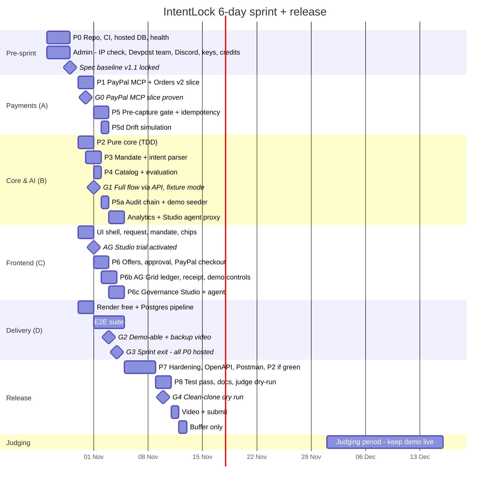

# IntentLock — Delivery Plan

> **6-day build sprint: Day 1 Fri 30 Oct → Day 6 Wed 04 Nov 2026** (sprint target: every P0 story live on the hosted URL). Spec baseline v1.1 locked Thu 29 Oct. Official deadline **Thu 12 Nov 2026 12:00 PT** (13 Nov 01:30 IST); internal submission target **Wed 11 Nov**. Task-level detail: [tasks.md](tasks.md).

## 1. Strategy

1. **De-risk payment first.** The PayPal MCP Server `create_order` → sandbox buyer approval → `get_order` gate → REST capture slice is built on Days 1–2, before AI or UI polish. It is the Stage-One pass/fail item.
2. **Pure core in parallel.** Policy, money, hash and state machine have no I/O, so one engineer builds them test-first while another integrates PayPal MCP + Orders v2.
3. **Fixture-first, live-second.** Every external dependency has a fixture/rule/stub adapter (catalog fixtures, rule parser, stub MCP server), so the full flow runs offline by G1 and access problems never block the team.
4. **Thin vertical slices, merged daily** to `main` behind green CI.
5. **P0 only inside the sprint.** US-1–US-8 (including AG Studio, drift simulation and the demo seeder) must be live by Day 6. P1 (OpenAPI/Postman) follows in hardening; P2 (webhooks, US-9) only if everything else is green.

## 2. Roles (merge if the team is smaller)

| Role | Owns | Primary files |
|---|---|---|
| **A — Payments** | PayPal MCP gateway, REST capture, pre-capture gate, idempotency, drift simulation, webhooks (P2) | `adapters/paypalMcp`, `adapters/paypal`, `services/CaptureGate`, `services/Demo` |
| **B — Core & AI** | Policy, money, hash, state machine, intent parser, Channel3 adapter, audit chain, analytics + Studio agent proxy, demo seeder | `core/*`, `adapters/intentParser`, `adapters/productSource`, `services/{Audit,Analytics,StudioAgent}` |
| **C — Frontend** | SPA flow, merchant preset chips, PayPal JS SDK v6 / react-paypal-js, AG Grid ledger, receipt, AG Studio Governance dashboard, demo controls, a11y | `apps/web/*` |
| **D — Quality & Delivery** | CI, native Node Render, E2E, README Judge Quickstart, Postman, video | `.github/`, `e2e/`, `render.yaml`, `README.md` |

Rule: any change to `core/policy`, `CaptureGate`, `PayPalMcpGateway` or state transitions needs review by a second person.

## 3. Schedule

| Dates | Phase | Exit criteria |
|---|---|---|
| Mon 26 – Wed 28 Oct | **P0 Foundation (pre-sprint)** | Clean clone → npm setup with hosted Postgres → `/api/health` 200 on two machines; no Docker; CI green; MIT license; `.env.example`; Copilot instructions |
| Mon 26 – Wed 28 Oct | **Admin (pre-sprint)** | Employer/IP check done by every member; all members registered on Devpost and in one team; PayPal Discord joined; Channel3 key + promo applied; Render $50 credit claimed; AI provider chosen with a spend cap ([submission.md](submission.md)) |
| Thu 29 Oct | **Day 0 — Baseline** | Spec v1.1 locked; research decisions D1–D5 accepted; tasks assigned |
| Day 1–2 · Fri 30 – Sat 31 Oct | **P1 PayPal MCP slice** | Fixed $1.00 purchase: MCP `create_order` → sandbox buyer approves → MCP `get_order` → REST capture → stored `COMPLETED`; cancel path works |
| Day 1–2 · Fri 30 – Sat 31 Oct | **P2 Pure core** | UNIT-POL/HASH/MONEY/SM green; ≥ 95 % coverage on `core/` |
| Day 2–3 · Sat 31 Oct – Sun 1 Nov | **P3 Mandate** | `POST /mandates` with LLM + rule fallback; clarification; confirm/version; merchant presets in `/config` |
| Day 3 · Sun 1 Nov | **P4 Discovery** | Channel3 live with 4 s timeout + fixture fallback; evaluation persisted |
| Day 3–4 · Sun 1 – Mon 2 Nov | **P5 Integrity** | Gate G1–G7 with MCP `get_order` + REST fallback; CAS transitions; `payment_operations`; hash-chained audit; drift simulation; demo seeder; INT-01..13 and INT-21..24 green |
| Day 3–5 · Sun 1 – Tue 3 Nov | **P6 UI** | Full UI flow; PayPal checkout; AG Grid ledger; receipt with MCP trace; demo controls; a11y pass |
| Day 5–6 · Tue 3 – Wed 4 Nov | **P6c Governance Studio** | AG Studio themed dashboard, default layout, custom Mandate Integrity & MCP Gate widget, Governance Analyst agent (E2E-14) |
| Day 6 · Wed 4 Nov | **Sprint exit (G3)** | All P0 stories (US-1–US-8) work on the warm hosted URL; E2E-01..17 green |
| Thu 5 – Sun 8 Nov | **P7 Hardening** | OpenAPI generated; Postman collection (happy path + tamper/drift); SEC-* green; rate limits; video recorded. Webhooks (P2) only if all of this is green |
| Mon 9 – Tue 10 Nov | **P8 Release** | Feature freeze; full test pass; README Judge Quickstart; G4 |
| Wed 11 Nov | **Submit** | Video uploaded (public, < 3 min); Devpost form complete; submitted |
| Thu 12 Nov | **Buffer** | Only fixes to submission text; no code changes after 06:00 PT |
| 25 – 30 Nov | **Judging prep** | Check Render free-service health and database expiry; recreate/migrate/re-seed if needed; 10-minute health ping configured; AG Studio trial expiry confirmed; live smoke repeated |
| 1 – 15 Dec | **Judging** | Demo live; daily health check; live smoke on 1 Dec and ~8 Dec; `main` frozen at the submission tag |

## 4. Quality gates (go / no-go)

| Gate | Date | Must be true | If not true |
|---|---|---|---|
| **G0 — PayPal MCP slice proven** | Day 2 · Sat 31 Oct | Order created via MCP `create_order`, read back via `get_order`, captured via REST with stored request IDs; status `COMPLETED` | All hands on PayPal until green; AI work pauses. If the MCP Server itself blocks us, run the gateway on REST behind the same interface and say so honestly (R16) |
| **G1 — Flow via API** | Day 3 · Sun 1 Nov | Request → mandate → offers → purchase → order → capture through HTTP (fixture + rule parser + stub MCP) | Move P1 items (OpenAPI, Postman) out of the sprint now |
| **G2 — Product demo-able** | Day 5 · Tue 3 Nov | E2E-01..13 and E2E-15 green in CI; hosted URL completes live smoke §6; **backup video recorded** | Drop Channel3 live → labelled fixtures. **Never drop the LLM** (hackathon requires an AI tool): if it is unreliable, keep it as drafter and let the rule parser validate/fill gaps (R3) |
| **G3 — Sprint exit** | Day 6 · Wed 4 Nov | All P0 stories live on the warm hosted URL, including AG Studio rendering real (or seeded) data, drift toggle and seeder | If AG Studio is not rendering real data → switch sponsor pitch to Channel3 (R10) and finish Studio in P7 |
| **G4 — Reproducible** | Tue 10 Nov | A teammate who did not write the setup runs from clean clone using README only (≤ 5 commands) | Fix README before anything else |

## 5. Risk register

| # | Risk | Likelihood | Impact | Early signal | Mitigation / fallback |
|---|---|---|---|---|---|
| R1 | PayPal sandbox/SDK friction (OAuth, CSP, popup) | Med | Critical | G0 at risk on Day 1 | Raw REST via `fetch`; PayPal Codespaces sample as reference |
| R2 | Channel3 key not granted or schema differs | Med | Med | Integration fails on Day 3 | Fixture provider (already P0, automatic fallback) with visible "Fixture Catalog" badge; list Channel3 only if actually integrated |
| R3 | LLM output unreliable | Med | Med | UNIT-PARSE failures in live smoke | Tighter JSON schema, few-shot examples, rule parser fills/validates; user confirms anyway |
| R4 | AI provider key/budget unavailable | Low | **Critical** (rules require AI) | No key by Day 0 (29 Oct) | Pick any provider with free tier; adapter makes swap ≤ 1 h |
| R5 | Render free service sleeps or DB expires during judging (1–15 Dec) | High | High | Free-tier plan in use | GitHub Actions health ping every 10 min; recreate free Postgres before its expiry, migrate, re-seed and verify; disclose free-tier limits |
| R6 | Scope creep (Bryntum, Workflows, extra sponsors) | High | High | New ideas after G1 | Scope fence in [README.md](README.md); changes require editing [spec.md](spec.md) |
| R7 | AG Grid React version mismatch | Low | Low | Install warnings | Pin `ag-grid-react` = `ag-grid-community` version |
| R8 | Video over 3 min or unclear | Med | High | First cut > 2:50 | Script below; record segments; rehearse twice |
| R9 | Secrets leaked in demo video/screenshots | Low | High | — | Use sandbox-only accounts; hide devtools env; gitleaks + manual frame review |
| R10 | AG Studio learning curve / trial access | Med | Med (sponsor prize only) | No themed dashboard by Day 5 (3 Nov) | Start from the official PayPal + AG Studio boilerplate; demo seeder gives it data from minute one; ask in Discord early; fallback sponsor pitch Channel3 |
| R11 | Hosted demo dies during judging (free DB expiry, free-service sleep, AG Studio trial expiry) | **High** if ignored | **Critical** | — | 10-minute health ping; recreate/migrate/re-seed free DB around 30 Nov when needed; verify service and disclose free-tier risks; [submission.md §7](submission.md#7-judging-period-runbook-115-dec) |
| R12 | Employer IP / eligibility conflict | Low–Med | **Critical** (disqualification) | — | IP check before Day 0; personal devices/accounts only |
| R13 | JS SDK v6 is newer; fewer examples | Med | Med | G0 at risk | Same server hooks work with `@paypal/react-paypal-js` buttons (ADR-012) |
| R14 | Judges score only from text/video (no hands-on) | High | High | — | Video and gallery must stand alone; README maps each criterion to evidence |
| R15 | Public demo abused (LLM cost) | Med | Med | Spend alerts | Rate limits, provider hard cap, agent kill switch, `DEMO_CONTROLS_ENABLED` switch |
| R16 | PayPal MCP Server friction (tool names/arguments, stdio process on Render, version changes) | Med | High | G0 at risk on Day 2 | Pin the version; contract test lists tools at startup; REST fallback behind the same `PayPalMcpGateway` interface; if MCP cannot ship, say so honestly in README/Devpost |
| R17 | Six-day sprint overload | High | High | Any P0 phase > 1 day late | Strict P0 order (payment → core → integrity → UI → Studio); P1/P2 never enter the sprint; a G3 slip moves Studio polish to P7, never payment work |

## 6. Judging criteria coverage

| Criterion | What we show | Artifact |
|---|---|---|
| Technological Implementation | Non-trivial PayPal use: **PayPal MCP Server** mediated by a deterministic gate (`create_order`, `get_order`), Orders v2 capture with stable `PayPal-Request-Id`, pre-capture verification of the live order, hash-chained audit + LLM structured extraction + AG Studio agent | Code, CI, [architecture.md](architecture.md) |
| Design | Five-step guided flow, merchant preset chips, decision chips, human-readable reasons, ledger, receipt with MCP trace, themed Governance Studio, judge scenario presets | Live app |
| Potential Impact | Specific user (SMB owner), specific problem (agent spend drift), demonstrated control | Video 0:00–0:20, README |
| Innovation | Buyer-side policy gate in front of PayPal MCP tools; mandate-hash binding + live-order capture gate + hash-chained receipt; positioned honestly vs Agent Ready/ACP/UCP | Video 1:20–2:20, [research.md](research.md) |
| Presentation | One coherent end-to-end run under 3 min, real sandbox capture, drift block on camera | YouTube video |

Targeted categories: **Best Use of PayPal + AI**, **Best Use of Agentic Commerce**, sponsor focus **Best Use of AG Grid** (AG Studio). Tie-breaks use the criteria in order, so Technological Implementation comes first.

## 7. Demo video script (under 3 minutes)

**Length: 2:50 (170 seconds).** This is a recording script, not evidence that a video exists. Record only after hosted live smoke, Gemini and AG Studio license checks pass. Use the real Sandbox SDK, never the offline E2E harness. Label the whole recording **PayPal Sandbox - test money**.

**Prepare off-camera:** configure fixture catalog, live Gemini intent/Studio, demo controls and licensed Studio. Sign in to the dedicated Sandbox buyer privately; hide credentials, bookmarks and notifications. In a second same-origin tab prepare a **Pre-capture drift** purchase at **Approval**, without clicking approval yet. Keep the main tab on **Request**. Rehearse buyer-popup duration; trim dead time transparently, never fabricate a capture.

| Time | Exact click path / screen | Narration |
|---|---|---|
| 0:00–0:12 | Main tab **Procurement → Request**, title and Sandbox label | "An AI agent can find a chair. It shouldn't decide what you pay for it. IntentLock is a buyer-side policy gate." |
| 0:12–0:32 | **Allowed purchase → Draft mandate**; show parser `gemini`, quantity 1, max $120, approved domain and no subscriptions | "Gemini drafts my constraints. I inspect the budget, merchant and subscription rule before confirming." |
| 0:32–0:52 | **Confirm mandate and find offers**; show ALLOWED chair and scroll to `OVER_BUDGET`, `RECURRING_NOT_ALLOWED`, `PRICE_UNKNOWN` | "These labelled fixtures exercise allow, block and review. Deterministic code makes each decision, not the model." |
| 0:52–1:05 | Allowed chair **Select offer → Approve this exact purchase** | "The server calculates 89 dollars. I approve this exact purchase, bound to a mandate hash." |
| 1:05–1:35 | **PayPal** button → Sandbox buyer popup → approve payment using the actual popup's approval button; return to **Captured - verified with PayPal (Sandbox)** | "The server calls PayPal MCP, then verifies PayPal's live order before REST capture. This is Sandbox test money, not a merchant purchase." |
| 1:35–1:47 | **View Intent Receipt**; show `create_order`, `get_order`, final capture evidence → **Close receipt** | "The receipt records the MCP trace, final payment evidence and tamper-evident chain." |
| 1:47–2:10 | Switch to prepared **Pre-capture drift** tab → **Approve this exact purchase**; show checked **Simulate Post-Approval Drift at the next capture**, **Drift scenario: Price hike** → **PayPal** → buyer approval | "This second request simulates post-approval drift. The live gate refuses capture: BLOCKED_AT_CAPTURE, DRIFT_AMOUNT_MISMATCH." |
| 2:10–2:22 | **Audit ledger → Quick filter: BLOCKED_AT_CAPTURE** → select row → show simulated badge → **Close receipt → Verify Audit Chain** | "The block has a receipt. The audit chain verifies INTACT; a blocked order is not a captured payment." |
| 2:22–2:43 | **Load Sample Procurement History → Governance Studio**; show sample disclosure, Mandate Integrity & MCP Gate → **Message input**: `Explain blocks and add a widget by primary reason.` → **Send message**; show actual new widget | "Sample history fills this session's dashboard without payments. The Governance Analyst can edit dashboard widgets, but it has no payment tools." |
| 2:43–2:50 | Hold app with Sandbox label and project URL | "AI proposes. Code enforces. You approve. Every purchase must stay inside your intent." |

PayPal's hosted popup labels can vary by locale/account. During rehearsal record its actual approval-button label in the recorder's private shot notes; do not invent a fixed label or show the login. If real upstream response time exceeds the slot, re-record or shorten narration while keeping the final cut at 2:50. If Gemini falls back to `rule` or the agent fails, stop and resolve it rather than claiming live AI evidence.

## 8. Definition of Done (per task)

- Typecheck, lint, unit and integration tests green in CI.
- New behavior covered by a test ID from [test-plan.md](test-plan.md).
- Loading / empty / error / success states implemented (UI tasks).
- No secrets or PII in code, logs, fixtures or screenshots.
- `contracts/api.md` and OpenAPI updated if routes changed.
- Reviewed by a second person for payment/policy code.

## 9. Submission checklist (Wed 11 Nov)

The full compliance matrix, Devpost text plan, Judge Quickstart and video checklist are in [submission.md](submission.md). Minimum:

- [ ] Every row of the [compliance matrix](submission.md#2-compliance-matrix-all-must-be--before-submitting) is ✅.
- [ ] Public GitHub repo; MIT license visible in About.
- [ ] README: problem, features, architecture diagram, setup (≤ 5 commands), env vars, **Judge Quickstart & Test Scenarios** (hosted URL, sandbox buyer login, 3 scenario presets, drift toggle, sample-history seeder), limitations, sponsor tools used and how.
- [ ] Hosted URL deployed and smoke-tested; free-tier availability and database expiry plan disclosed.
- [ ] Video public on YouTube, < 3:00, no copyrighted music, sandbox labelled.
- [ ] Devpost text explains how PayPal is central and which AI is used.
- [ ] CI green on the submitted commit; tag `v1.0.0-submission`.
